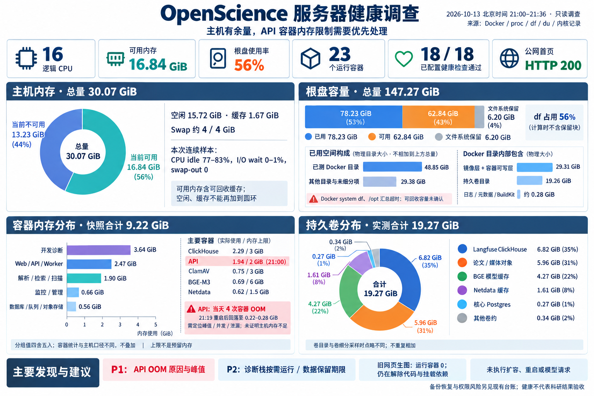

# 2026-10-13 服务器健康与资源调查

有日期的只读观察：北京时间21:00–21:02资源快照，21:19–21:20 API复采，21:36内核归属核对。当前发布和操作状态仍由CURRENT管理。本页不自动授权清理、扩容或重启。

采样时应用身份为`f804348c47da164d1632b7708dedbc39437f2150`，release/source一致且本仓可解析。该身份只锚定此次数据，后续操作前仍须核实际active/rollback。

## 结论

- 主机16逻辑CPU，30.07 GiB内存，可用16.84 GiB；连续样本CPU idle 77–83%、I/O wait 0–1%、swap-out 0，未证实整机资源饱和。
- 公网首页HEAD 200；23个运行容器，18个有健康检查且全部healthy，另5个未配置检查，不能称23/23 healthy。
- **P1：当前API容器当天触发4次内存cgroup OOM**，19:18、20:03、20:09、21:19与该容器ID和重启4次吻合。21:00为1.94/2 GiB；21:19自动重启后复采约0.22–0.28 GiB。没有做API启停或扩容；尚未定位引起峰值的具体请求、并发或泄漏。
- Swap约4/4 GiB已使用，但本次没有连续swap-out；不能仅据Swap满认定当前主机缺内存。
- 根盘df为56%，可用62.84 GiB；Docker system df和/opt汇总超时，可回收容量未确认，不套用旧采样数字。

## 主机口径

| 项目 | GiB |
|---|---:|
| 内存总量 | 30.07 |
| 可用（含可回收内存） | 16.84 |
| 当前不可用（total − available） | 13.23 |
| 空闲 | 15.72 |
| buff/cache | 1.67 |
| 根盘总量 | 147.27 |
| 根盘已用 | 78.23 |
| 普通可用空间 | 62.84 |
| 文件系统保留块 | 6.20 |

空闲、缓存与可用重叠，不再加到内存圆环；df 56%的分母不含保留块。

## 各容器内存与CPU

21:00的独立容器采样合计约9.22 GiB。开发诊断3.64、Web/API/Worker 2.47、解析/检索/扫描1.90、监控/管理0.66、数据库/队列/对象0.56 GiB。各分组四舍五入；Docker容器统计与主机used口径不同，不能相加。上限不是预留，CPU百分比以一个逻辑CPU为基准。

| 容器 | Docker实测占用 / 显示上限 | CPU |
|---|---|---:|
| openscience-prod-web-1 | 123.5MiB / 1GiB | 9.22% |
| openscience-prod-api-1 | 1.937GiB / 2GiB | 0.00% |
| openscience-prod-agent-worker-1 | 423.1MiB / 2GiB | 2.08% |
| openscience-prod-scansci-mcp-1 | 99.07MiB / 2GiB | 0.13% |
| openscience-prod-document-parser-1 | 93.28MiB / 512MiB | 0.36% |
| openscience-prod-embedding-worker-1 | 703.6MiB / 6GiB | 0.01% |
| openscience-prod-postgres-1 | 202.5MiB / 2GiB | 0.84% |
| openscience-prod-malware-scanner-1 | 765MiB / 3GiB | 0.00% |
| openscience-prod-object-storage-1 | 366.7MiB / 3GiB | 1.38% |
| openscience-prod-redis-1 | 3.379MiB / 512MiB | 0.33% |
| netdata | 637.9MiB / 1.5GiB | 21.82% |
| openscience-development-catalog-catalog-1 | 114.4MiB / 2GiB | 0.12% |
| openscience-development-serena-serena-1 | 78.59MiB / 3GiB | 0.34% |
| openscience-development-gateway-audit | 39.58MiB / 256MiB | 0.01% |
| openscience-development-langfuse-web-1 | 587.6MiB / 2GiB | 0.48% |
| openscience-development-langfuse-worker-1 | 428.1MiB / 1.5GiB | 0.62% |
| openscience-development-langfuse-clickhouse-1 | 2.29GiB / 3GiB | 154.06% |
| openscience-development-langfuse-redis-1 | 7.465MiB / 512MiB | 0.49% |
| openscience-development-langfuse-minio-1 | 101.5MiB / 512MiB | 0.00% |
| openscience-development-langfuse-postgres-1 | 20.75MiB / 512MiB | 0.00% |
| openscience-prod-paper-analysis-1 | 279.8MiB / 8GiB | 0.12% |
| vnstat | 2.41MiB / 128MiB | 0.00% |
| portainer | 30.82MiB / 30.07GiB | 0.00% |

## 磁盘分布

| 视图 / 项目 | GiB | 口径 |
|---|---:|---|
| Docker已测目录 | 48.85 | 以下层、卷和日志/元数据之和 |
| 镜像层与容器可写层 | 29.31 | overlay2；不是全可回收镜像 |
| 持久卷目录 | 19.26 | du allocated bytes |
| 日志、image元数据、BuildKit | 约0.28 | 独立目录 |
| 其他目录及未细分项 | 29.38 | 根盘used减上述已测Docker；包含尚未测完的/opt |
| /usr | 4.17 | 属于上行，不重复加 |
| /var/backups | 3.81 | 属于上行 |
| /root | 2.79 | 属于上行 |
| /var/log | 0.76 | 属于上行 |

### 持久卷细分

卷逐项采样合计约19.27 GiB，与父目录采样时点略有差异。它们属于上述Docker卷，不再与磁盘总量相加。

| 持久数据 | GiB |
|---|---:|
| Langfuse ClickHouse | 6.82 |
| SeaweedFS论文 / 媒体对象 | 5.96 |
| BGE模型缓存 | 4.27 |
| Netdata缓存 | 1.61 |
| 核心Postgres | 0.27 |
| 其他卷 | 约0.34 |

对象、模型缓存和卷大小不构成删除依据；Langfuse与Netdata可先核数据保留期限和实际使用，不先增加服务。

## 证据与未确认范围

原始选定字段与图像提示词：交付树ignored `tmp/server-health-20261013/` 中snapshot/followup/kernel/summary JSON、采集脚本及`health-image-prompt.md`。没有Env、Secret、论文正文或dump输出。第一版OOM解析只找Killed-process文本，未命中不代表无OOM；最终以oom-kill cgroup通知、容器ID和restart count核对。

/opt与Docker logical usage查询超时，未声称完全的镜像可回收调查；没有压力测试、恢复演练、真实模型请求或具体502请求的归因。图为内置生图后的实测数值说明版，已核数字和分母，非Netdata截图。健康与资源余量不能证明科研结果质量。
