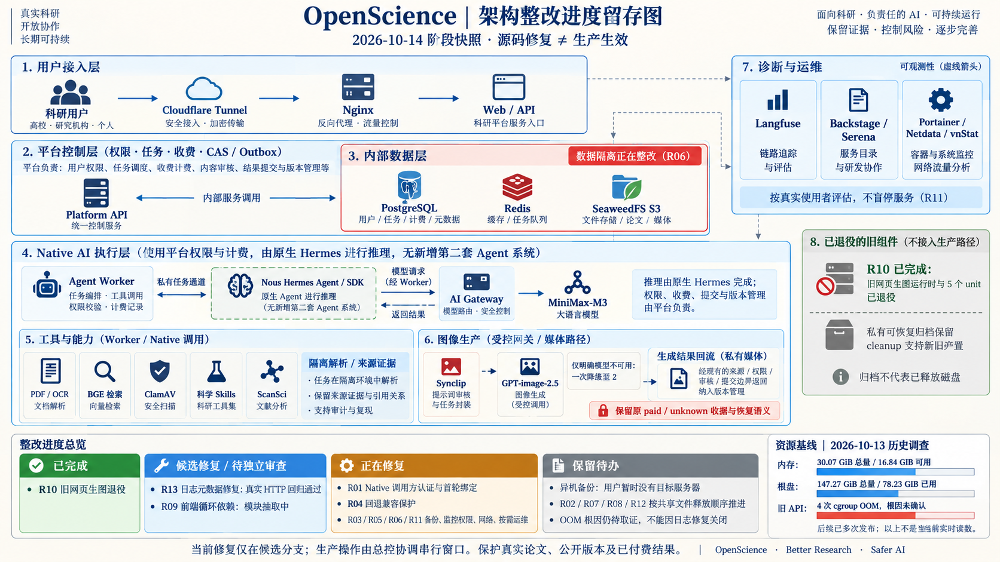

# OpenScience 架构整改阶段快照

用户要求生成图片供留存。本图由内置 image_gen 生成，记录 2026-10-14 架构修复中的阶段事实，不是实时监控或整改完成证明。

- 源码基线：95f8ccaac49c85c4ff457afc202999a9e665f288；修复分支 codex/architecture-remediation。
- R10 已退役，私有可恢复归档及 cleanup 双位置读取保留；没有宣称磁盘空间释放。
- R13 日志缺陷有真实 Fastify HTTP RED/GREEN 证据；图生成时修复尚待独立审查、集成与发布，OOM 根因未确认。
- R09 只抽共享 context/hook 和嵌入出版内容，图生成时验证尚未完成。
- R01/R04/R03/R05/R06/R11 正在实施；R02/R07/R08/R12 依共享源码写权交回顺序继续。
- 用户暂时没有异机目标服务器，异机备份保留待办；本机备份不构成 ECS 丢失后的灾备保障。
- 资源数字来自 2026-10-13 调查，随后已多次发布，不是当前实时读数。精确分布见同目录原 server-resources 文档。

后续修复、部署和验证事实归唯一 CURRENT 与原能力台账，本图保留当时状态；总控负责索引与状态同步。

## 生成提示词

Create a professional Chinese-language architecture and remediation infographic, landscape 16:9, high resolution, suitable for long-term archiving. Use a calm ivory background, dark navy readable Chinese typography, restrained vermilion for outstanding risks, blue for source-only fixes, green only for confirmed completed retirement. Crisp thin arrows and labeled boxes, generous spacing, technical editorial style. All labels legible; no decorative fake terminal output or invented measurements.

Exact headline: "OpenScience｜架构整改进度留存图"
Subtitle: "2026-10-14 阶段快照 · 源码修复 ≠ 生产生效"
Make the principal area a complete architecture flow with clear responsibility boundaries:
1) Top user entry: 科研用户 → Cloudflare Tunnel → Nginx → Web / API.
2) Platform control layer API → Domain "权限 · 任务 · 收费 · CAS / Outbox"; API and Worker use internal PostgreSQL / Redis / SeaweedFS S3, drawn in an internal data layer. Label "数据隔离正在整改（R06）", not falsely claim it has already happened.
3) Native AI execution: Agent Worker → 私有任务通道 → Nous Hermes Agent / SDK; model requests from Native agent go back through Worker → AI Gateway → MiniMax-M3. Show that reasoning is by native Hermes, while permissions/charging/commit are by platform, with no new second agent system.
4) Tools used by Worker / Native: PDF / OCR、BGE 检索、ClamAV、科学 Skills、ScanSci. Show "隔离解析 / 来源证据".
5) Image production from controlled gateway/media path: Synclip → GPT-image-2.5; small note "仅明确模型不可用：一次降级至 2"; generated image returns as private media via existing source/permission/review/submit boundaries. Small protected row "保留原 paid / unknown 收据与恢复语义".
6) Side administrative panel "诊断与运维" with Langfuse、Backstage / Serena、Portainer / Netdata / vnStat; dotted arrows mean observability; note "按真实使用者评估，不盲停服务（R11）".
7) Lower retired panel in grey/green: "R10 已完成：旧网页生图运行时与 5 个 unit 已退役"; "私有可恢复归档保留 · cleanup 支持新旧位置". It must not connect to active production path. Note "归档不代表已释放磁盘".

Below the architecture, a clearly separated remediation strip with 4 equally clear status columns:
A green "已完成" card: "R10 旧网页生图退役".
B blue "候选修复 / 待独立审查" card: "R13 日志元数据修复：真实 HTTP 回归通过"; "R09 前端循环依赖：模块抽取中".
C amber "正在修复" card: "R01 Native 调用方认证与首轮绑定"; "R04 回退兼容保护"; "R03 / R05 / R06 / R11 备份、监控权限、网络、按需运维".
D grey "保留待办" card: "异机备份：用户暂时没有目标服务器"; "R02 / R07 / R08 / R12 按共享文件释放顺序推进"; "OOM 根因仍待取证，不能因日志修复关闭".

Small historical health inset at lower right, heading EXACT: "资源基线｜2026-10-13 历史调查"
Display three fact pairs with simple illustrative bars, NOT live monitor:
"内存：30.07 GiB 总量 / 16.84 GiB 可用"
"根盘：147.27 GiB 总量 / 78.23 GiB 已用"
"旧 API：4 次 cgroup OOM，根因未确认"
Caption "后续已多次发布；以上不是当前实时读数".
Do not add CPU, memory limits or totals not provided. Do not call service healthy proof of scientific quality or prove source deployed.
Footer exact: "当前修复仅在候选分支；生产操作由总控协调串行窗口。保护真实论文、公开版本及已付费结果。"
Avoid claiming full remediation finished, production changed, offsite backup exists, or old image channel still active.
