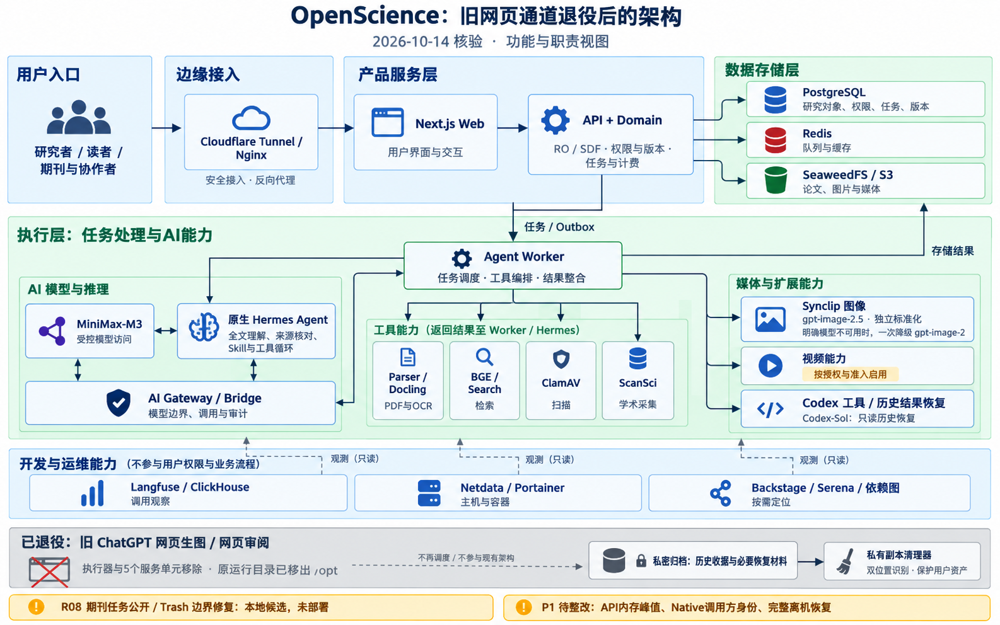

# 2026-10-14 旧网页通道退役后的架构

这是基于源码和2026-10-14 01:26（北京时间）运行元数据的功能与职责图，不是实时监控或科学质量验收。实际下一动作与当前版本仍由唯一CURRENT管理。



观察时应用为`ec2eb95103f7ea1265513bb3bd6def1765d2dd25`，回退为`597a2715dec593f0f842b908d7a8df257a1bbd65`；两版已解除旧网页依赖。Synclip实际独立运行包为597a，私有副本清理包为ec2。5个旧unit均not-found，所有运行容器无旧root挂载；旧root已原子移动至私密归档，目录与锁身份、权限保留，3个核心容器healthy且移动前后ID不变。

图按职责分组，未逐一画出诊断栈所有容器；全容器资源口径见[10-13资源明细](2026-10-13-server-resources.md)。AI Gateway/Bridge表示受控调用与审计职责，不声称Hermes的所有联网都经同一物理路由。开发运维工具不赋予科研用户运维权限。视频仍受独立授权和准入；R08只是本地候选，未随退役发布。

原始只读回读及归档receipt保存在canonical的ignored `tmp/server-health-20261013/`，服务器恢复工具与私密receipt见deployment的退役节。没有删除用户SQL/S3、paid/unknown材料，也没有新增生产模型请求。图使用内置生图工具生成，下面保留完整提示词。

## 生图提示词

```text
Create a polished, highly legible architecture infographic, landscape 16:10, high resolution, white background with navy headings, pale blue product boxes, green execution/data boxes, grey retired area, restrained amber notes. Clean professional engineering diagram, precise orthogonal arrows, generous spacing, Chinese labels exactly as provided with English technology names. No decoration that obscures relationships. Title: 'OpenScience：旧网页通道退役后的架构'. Subtitle: '2026-10-14 核验 · 功能与职责视图'. This is an evidence-based functional architecture, not a live monitoring dashboard.
Use clearly separated areas and this complete topology:
1) TOP ENTRY: '研究者 / 读者 / 期刊与协作者' → 'Cloudflare Tunnel / Nginx' → 'Next.js Web' → 'API + Domain'. Inside Domain caption: 'RO / SDF · 权限与版本 · 任务与计费'. Web and API are product services, not development tools.
2) DATA area to the right of Domain: 'PostgreSQL' caption '研究对象、权限、任务、版本'; 'Redis' caption '队列与缓存'; 'SeaweedFS / S3' caption '论文、图片与媒体'. API/Domain connects to these. User assets remain protected. Do not show a public DB port.
3) EXECUTION area beneath Domain: Domain arrow labeled '任务 / Outbox' → 'Agent Worker'. Worker branches to '原生 Hermes Agent' with caption '全文理解、来源核对、Skill与工具循环'; adjacent 'MiniMax-M3' caption '受控模型访问'. Show model connection to Hermes, without inventing a claim that all Hermes networking uses a particular direct route. Include shared 'AI Gateway / Bridge' caption '模型边界、调用与审计' connected to Worker and the controlled model area. Worker also connects to four small tool blocks: 'Parser / Docling：PDF与OCR', 'BGE / Search：检索', 'ClamAV：扫描', 'ScanSci：学术采集'. Show tools returning results to the Worker/Hermes area.
4) MEDIA execution blocks: 'Synclip 图像' caption 'gpt-image-2.5 · 独立标准化'; small second line '明确模型不可用时，一次降级 gpt-image-2'. Connected from Worker, and results go to SeaweedFS/S3. '视频能力' caption '按授权与准入启用' (amber small note, no claim of new video execution). 'Codex 工具 / 历史结果恢复' and a small 'Codex-Sol：只读历史恢复' caption, outside the retired Web channel. Do not label current Codex or ScanSci as retired.
5) Separate DEVELOPMENT / OPERATIONS panel, with no user permission arrow: heading '开发与运维能力'; blocks 'Langfuse / ClickHouse：调用观察', 'Netdata / Portainer：主机与容器', 'Backstage / Serena / 依赖图：按需定位'. Thin dashed observation links to product/execution, not model generation requests.
6) Bottom RETIRED panel grey, with crossed execution symbol and NO live dispatch arrow: heading '已退役：旧 ChatGPT 网页生图 / 网页审阅'; caption '执行器与5个服务单元移除 · 原运行目录已移出 /opt'. Next to it a protected archive icon '私密归档：历史收据与必要恢复材料'. Small '私有副本清理器' connected to archive, caption '双位置识别 · 保护用户资产'. Do not imply disk data was destroyed or 1.2 GiB was freed. Do not draw the old browser as an active dependency of Synclip, Hermes, or API.
Footer separate amber label: 'R08 期刊任务公开 / Trash 边界修复：本地候选，未部署'. Second footer: 'P1 待整改：API内存峰值、Native调用方身份、完整离机恢复'. Keep these two footers outside the active runtime boxes. No resource numbers, extra services, new gateways or generic AI robot imagery. All arrows should be unambiguous and all Chinese text readable.
```
